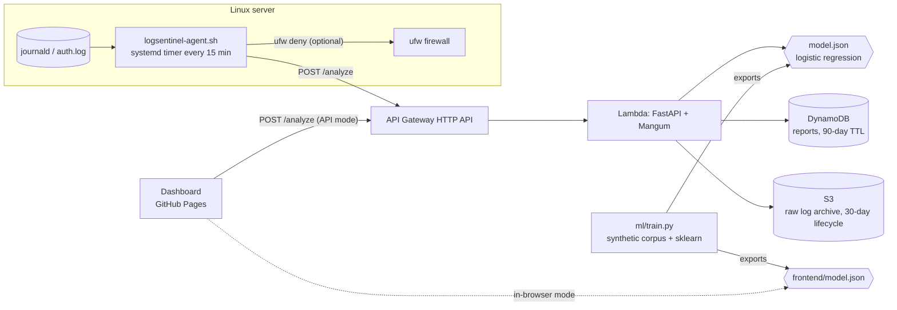

# 🛡️ LogSentinel: ML threat scoring for Linux SSH logs

[](https://github.com/Gonugunta-Venkata-Jayanth/LogSentinel/actions/workflows/ci.yml) [](LICENSE)

> **Themes:** Linux · Machine Learning · AWS Serverless (Free Tier) · Data analysis
> **Stack:** Python 3.12, FastAPI, scikit-learn, Mangum, AWS SAM (Lambda + HTTP API + DynamoDB + S3), Bash + systemd, vanilla JS + Chart.js, Docker, GitHub Actions

**Live dashboard:** https://jayanth-gonugunta-venkata.netlify.app/demos/logsentinel/ (runs the model fully in your browser; click *Load sample*)

## The problem

Any Linux box with port 22 open gets thousands of SSH login attempts a day. `fail2ban` uses a fixed
"N failures in M minutes" rule. That misses **credential stuffing** (many usernames, slow) and
**low-and-slow** attackers (a handful of tries spread over hours), and it can lock out a real user who
fumbles a password. LogSentinel parses `auth.log`/journald, builds behavioural features per source IP,
and scores each IP with a trained model: **ok**, **suspicious** or **block**.

## Architecture



**Training and serving share the same code.** `ml/train.py` renders realistic OpenSSH log lines for five
behaviours (legit, fumbling user, brute force, credential stuffing, low-and-slow), then pushes them through
the **same** `parser.py` and `features.py` the API uses. The trained scaler and coefficients are exported to
`model.json`. Serving needs only the standard library, so the Lambda package is tiny and cold starts are fast.
`frontend/engine.js` is a line-for-line JS port, and a CI parity test checks that it scores the sample log
the same way Python does.

### Features (per source IP)

| feature | why it matters |
|---|---|
| `failed_count` | volume of failures (log-scaled) |
| `unique_users` | stuffing tries many usernames |
| `invalid_user_count` | attempts on accounts that don't exist |
| `success_count` | real users succeed |
| `fail_ratio` | failures / attempts |
| `root_attempts` | brute force loves `root` |
| `attempts_per_min` | shown to analysts. Left out of the model because it made 5-fold CV AUC worse (a fumbling human looks "fast" too) |

**Model metrics** (held-out 25%, 3% label noise injected to mimic imperfect labels): see `ml/metrics.json`.
Currently ROC-AUC 0.961, precision 0.947, recall 0.942. *The corpus is synthetic. Retrain on your own
labelled logs before trusting it in production.*

## API

| method | path | description |
|---|---|---|
| GET | `/health` | status, model version, storage backend |
| GET | `/model` | the exported model spec |
| POST | `/analyze` | `{log, host?, year?, save?}` → ranked IPs + summary, stored as a report |
| GET | `/reports` | latest reports (summary only) |
| GET | `/reports/{id}` | full report |
| GET | `/blocklist?report_id=` | IPs with verdict `block`, ready for ufw/iptables |

## Run locally

```bash
make install         # backend deps + dev tools
make train           # regenerate corpus, retrain, export model.json
make test            # pytest (parser, features, model, API, DynamoDB via moto) + JS parity test
make run             # API :8000 + dashboard :8080
# or the full stack in containers:
docker compose up --build   # open http://localhost:8080/?api=http://localhost:8000
```

## Deploy (all free)

### Dashboard: GitHub Pages
Already automated: `.github/workflows/pages.yml` publishes every project's `frontend/` to the `gh-pages`
branch. One-time setup: **repo Settings → Pages → Source: Deploy from a branch → `gh-pages` / root**.

### API: AWS Free Tier (Lambda + HTTP API + DynamoDB + S3)
```bash
# prerequisites: AWS account, `aws configure`, AWS SAM CLI, Docker
cd infra
sam build --use-container
sam deploy --guided        # accept defaults; stack name "logsentinel"
# copy the ApiUrl output into the dashboard's "API URL" box (or ?api=<url>)
```
Free-tier notes: DynamoDB is **provisioned 5/5 RCU/WCU** (inside the always-free 25/25), Lambda is arm64
at 256 MB (1M requests/month free), logs keep 7 days, S3 objects expire after 30 days, and HTTP API is throttled
to 10 req/s, so a runaway client can't run up a bill. Tear down with `sam delete`.

### Agent on a Linux server
```bash
cd agent
sudo ./install.sh https://<ApiUrl>        # report only
sudo ./install.sh https://<ApiUrl> 1      # also `ufw deny` IPs scored "block"
journalctl -t logsentinel -f
```
The agent runs as a hardened systemd `oneshot` service on a 15-minute timer (`RandomizedDelaySec`,
`Persistent=true`). It reads journald (or `/var/log/auth.log` / `/var/log/secure`) and needs `curl` + `jq`.

## Project layout

```
backend/   FastAPI app, parser, features, model runtime, storage (SQLite | DynamoDB), tests, Dockerfile
ml/        synthetic corpus generator + training/export script, metrics
frontend/  static dashboard (in-browser engine + Chart.js), JS parity test
agent/     bash shipper, systemd service + timer, installer
infra/     AWS SAM template + samconfig
samples/   demo auth.log and golden scores
```

## Ideas for next iteration
- GeoIP/ASN enrichment and a map view
- Gradient-boosted model exported to ONNX, compared against the linear baseline
- Publish the blocklist to AWS WAF IP sets
